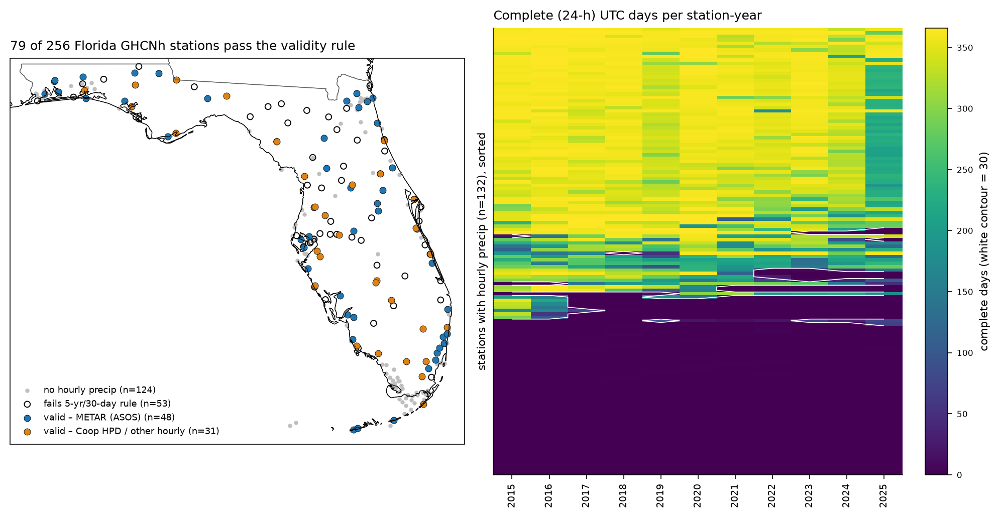
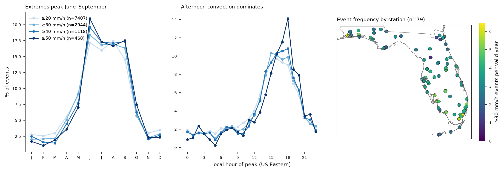
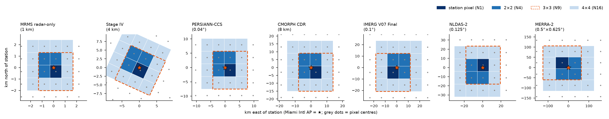
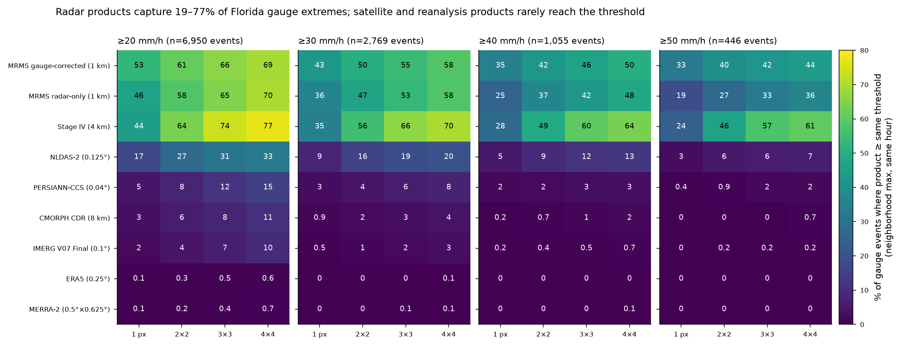
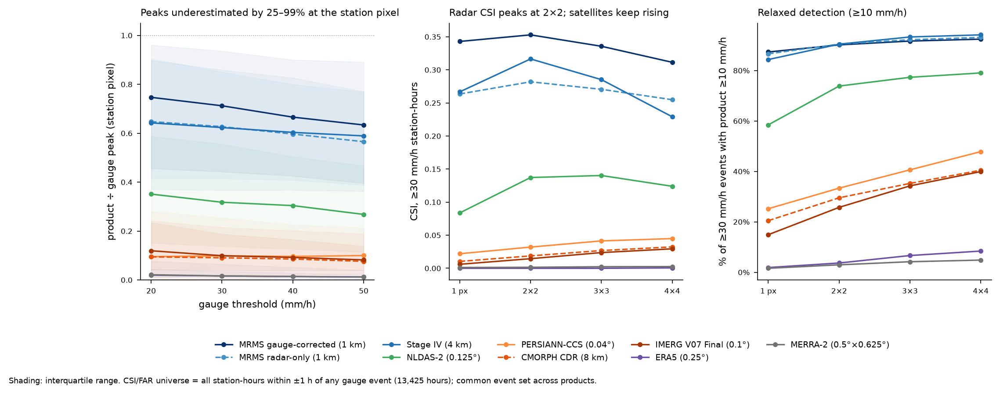
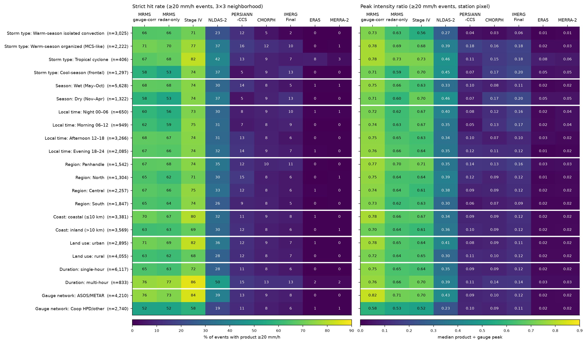

# How well do gridded precipitation products capture hourly rainfall extremes in Florida? (2015–2025)

**Ground truth:** GHCNh hourly gauges. **Products:** 9 gridded datasets. **Thresholds:** ≥20, ≥30, ≥40, ≥50 mm/h. **Neighborhoods:** 1, 2×2, 3×3, 4×4 pixels.

## 1. Ground truth (GHCNh)
* Of the 256 Florida GHCNh stations, 132 report hourly precipitation. **79 pass the validity rule:** at least 5 years in 2015–2025, each with at least 30 complete UTC days (24 valid hourly values). 48 are ASOS/METAR stations and 31 are Coop HPD or other hourly gauges ([valid_stations.csv](../out/valid_stations.csv)).
* **How the hourly values were built.** METAR hourly totals use the last routine FM‑15 report of the clock hour (minute ≥45). That report holds the running total for the hour, as the GHCNh documentation (section IX) specifies. Each value is assigned to the hour starting at HH:00 UTC. Records with quality code 2 (suspect) or G (failed gap check) were removed.
* **Why stations fail.** Military airfields and many AWOS sites only carry a precipitation value when rain occurs. They therefore can never show 24 complete hours and fail the rule. They could be recovered if a missing precipitation group in a routine report were treated as zero.
* **Event lists.** An event is one or more exceedance hours at a station, with hours less than 6 h apart merged into one event. Isolated spikes and values above 150 mm/h are *flagged* in the lists and excluded from scoring.

| threshold | exceedance hours | events | stations |
|---|---|---|---|
| ≥20 mm/h | 8,632 | 7,466 | 79 |
| ≥30 mm/h | 3,271 | 2,996 | 79 |
| ≥40 mm/h | 1,244 | 1,169 | 79 |
| ≥50 mm/h | 511 | 485 | 77 |

Event lists: [≥20](../out/events_ge20_labeled.csv), [≥30](../out/events_ge30_labeled.csv), [≥40](../out/events_ge40_labeled.csv), [≥50](../out/events_ge50_labeled.csv). Each row carries its condition labels.

## 2. Products and method
| Product | Resolution | Source / access |
|---|---|---|
| MRMS gauge-corrected | 1 km, hourly | GaugeCorr_QPE_01H until Oct 2020, then MultiSensor_QPE_01H_Pass2 (Iowa State mtarchive) |
| MRMS radar-only | 1 km, hourly | RadarOnly_QPE_01H (Iowa State mtarchive) |
| Stage IV | 4 km, hourly | NCEP ST4 01h (Iowa State mesonet archive) |
| NLDAS-2 forcing | 0.125°, hourly | NASA Cloud OPeNDAP (domain starts at 25.06°N, so the Keys are not covered) |
| PERSIANN-CCS | 0.04°, hourly | UC Irvine CHRS |
| CMORPH v1 CDR | 8 km, 30 min | NOAA NCEI |
| IMERG V07 Final | 0.1°, 30 min | NASA Cloud OPeNDAP (available through 29 Sep 2025) |
| ERA5 total precipitation | 0.25°, hourly | Copernicus CDS (2015–2021) + DestinE Earth Data Hub Zarr (2022–2025); the two sources agree to ≤0.004 mm/h on overlapping hours |
| MERRA-2 PRECTOTCORR | 0.5°×0.625°, hourly | NASA Cloud OPeNDAP |

**Not evaluated.** ERA5-Land: the download is set up on DestinE Earth Data Hub, but the server throughput (~0.15 MB/s) put the 2015–2025 Florida subset at several hours, so it is deferred. GSMaP needs a JAXA account.

**Timing check.** Each product's time convention was verified against the gauges by lag correlation over all station-hours. IMERG, CMORPH, PERSIANN-CCS, Stage IV and both MRMS versions peak at lag 0. NLDAS-2 peaks at +1 h, meaning its timestamps mark the end of the hour, so it was shifted by 1 h. ERA5 timestamps mark the end of the accumulation hour and were converted to hour start; ERA5 then peaks at lag 0, though its profile is nearly flat (r = 0.20), as is MERRA-2's ([product_time_alignment.csv](../out/product_time_alignment.csv)).

**Neighborhoods.**
* N1 is the pixel containing the station.
* N4 and N16 are the 2×2 and 4×4 blocks whose centre is closest to the station.
* N9 is the 3×3 block centred on N1.
* Each neighborhood's value is its pixel **maximum**. Physical size differs enormously: N16 is 17 km² for MRMS but 54,585 km² for MERRA-2 ([neighborhood_definitions.csv](../out/neighborhood_definitions.csv)).

**Metrics.** All metrics use the **common event set**: events where every product has data, giving 6,950 / 2,769 / 1,055 / 446 events for ≥20/30/40/50 mm/h.
* *Strict hit:* the product's neighborhood maximum in the same hour reaches the same threshold. Confidence intervals are 95% station-block bootstrap.
* *Relaxed hit:* the product reaches ≥10 mm/h.
* *Peak ratio:* product ÷ gauge peak.
* *POD/FAR/CSI:* computed over all station-hours within ±1 h of any gauge event (13,425 hours). This window concentrates on storm hours, so FAR here is not a climatological false-alarm rate.

## 3. Results — which product catches the extremes?
| Product | Type | ≥20: 1 px | ≥20: 4×4 | ≥30: 1 px | ≥30: 4×4 | ≥50: 1 px | ≥50: 4×4 | peak ratio (≥30, 1 px) | best CSI (≥30) |
|---|---|---|---|---|---|---|---|---|---|
| MRMS gauge-corrected (1 km) | radar+gauge | 53% (49–57) | 69% (65–73) | 43% (38–47) | 58% (53–63) | 33% (27–39) | 44% (38–50) | 0.71 | 0.35 (2×2) |
| MRMS radar-only (1 km) | radar | 46% (43–50) | 70% (66–74) | 36% (32–40) | 58% (54–62) | 19% (14–24) | 36% (32–41) | 0.63 | 0.28 (2×2) |
| Stage IV (4 km) | radar+gauge | 44% (41–48) | 77% (73–81) | 35% (31–39) | 70% (65–74) | 24% (19–30) | 61% (53–67) | 0.62 | 0.32 (2×2) |
| NLDAS-2 (0.125°) | gauge/radar-based reanalysis forcing | 17% (14–20) | 33% (30–37) | 8.7% (6.8–10.9) | 20% (17–23) | 2.7% (1.1–4.8) | 6.7% (4.4–9.5) | 0.32 | 0.14 (3×3) |
| PERSIANN-CCS (0.04°) | satellite (IR) | 5.0% (4.4–5.6) | 15% (14–16) | 2.6% (2.1–3.2) | 8.1% (6.9–9.4) | 0.4% (0.0–1.1) | 1.8% (0.7–2.9) | 0.10 | 0.04 (4×4) |
| CMORPH CDR (8 km) | satellite (MW+IR, bias-corrected) | 3.3% (2.8–3.7) | 11% (10–12) | 0.9% (0.6–1.3) | 4.1% (3.3–5.0) | 0.0% (0.0–0.0) | 0.7% (0.0–1.5) | 0.09 | 0.03 (4×4) |
| IMERG V07 Final (0.1°) | satellite (MW+IR, gauge-adjusted) | 1.9% (1.5–2.4) | 9.5% (8.7–10.4) | 0.5% (0.3–0.8) | 2.9% (2.2–3.6) | 0.0% (0.0–0.0) | 0.2% (0.0–0.7) | 0.10 | 0.03 (4×4) |
| ERA5 (0.25°) | atmospheric reanalysis | 0.1% (0.0–0.2) | 0.6% (0.5–0.8) | 0.0% (0.0–0.0) | 0.1% (0.0–0.2) | 0.0% (0.0–0.0) | 0.0% (0.0–0.0) | 0.02 | 0.00 (4×4) |
| MERRA-2 (0.5°×0.625°) | atmospheric reanalysis | 0.1% (0.0–0.2) | 0.7% (0.5–0.8) | 0.0% (0.0–0.0) | 0.1% (0.0–0.2) | 0.0% (0.0–0.0) | 0.0% (0.0–0.0) | 0.02 | 0.00 (4×4) |

Hit-rate cells give strict hit rate (95% CI); "4×4" is the 16-pixel neighborhood. Full tables: [detection_scores.csv](../out/detection_scores.csv).

**Key findings**
1. **Radar products are the only ones that routinely reach the gauge threshold.** At the station pixel, MRMS gauge-corrected is best (53% of ≥20 mm/h and 33% of ≥50 mm/h events). With larger neighborhoods, Stage IV overtakes it: 77% (≥20) and 61% (≥50) at 4×4, a 16 km box. Radar-only MRMS stays close to the gauge-corrected version for moderate thresholds but falls behind for ≥50 mm/h (19% vs 33% at 1 px).
2. **Neighborhood size has opposite effects for radar and satellite products.** For radar, hit rates rise with neighborhood size, but CSI peaks at 2×2 and then falls because false alarms grow. For satellites, CSI keeps rising up to 4×4: their errors are dominated by smoothing and displacement, not false alarms.
3. **Satellite products miss the intensity, not the storm.** IMERG, CMORPH and PERSIANN-CCS detect rain ≥10 mm/h at a 4×4 neighborhood in about 40–48% of ≥30 mm/h events. They almost never reach the gauge value: median peak ratio is about 0.10, and even at 4×4 the strict hit rate at ≥30 mm/h is only 3–8%. PERSIANN-CCS, at 0.04° and IR-based, has the highest strict hit rate of the satellites.
4. **The reanalyses are unsuitable for hourly point extremes.** ERA5 and MERRA-2 essentially never reach 20 mm/h: ERA5's strict hit rate is 0.1% at the station pixel and 0.6% at 4×4, with a median peak ratio of 0.02 (0.09 at 4×4). ERA5 does register rain ≥1 mm/h in 41–72% of events (1 px to 4×4), so it places the storm but cannot represent the convective peak. NLDAS-2 does better (17–33% at ≥20 mm/h) only because its hourly precipitation is built from gauges and Stage II/IV radar.
5. **Every product underestimates peaks, and radar does so more for stronger events.** MRMS gauge-corrected falls from a ratio of 0.75 at ≥20 mm/h to 0.63 at ≥50 mm/h.

## 4. In which conditions? (3,025 isolated convection, 2,222 organized/MCS-like, 406 tropical cyclone, 1,297 cool-season events at ≥20 mm/h)
Each cell gives the strict hit rate at 3×3 / median peak ratio at the station pixel.

| Product | Warm-season isolated convection | Warm-season organized (MCS-like) | Tropical cyclone | Cool-season (frontal) |
|---|---|---|---|---|
| Stage IV (4 km) | 71% / 0.56 | 77% / 0.68 | 82% / 0.73 | 74% / 0.70 |
| MRMS radar-only (1 km) | 66% / 0.63 | 70% / 0.69 | 68% / 0.73 | 53% / 0.59 |
| PERSIANN-CCS (0.04°) | 12% / 0.04 | 16% / 0.18 | 13% / 0.11 | 5% / 0.07 |
| CMORPH CDR (8 km) | 5% / 0.03 | 12% / 0.16 | 9% / 0.15 | 9% / 0.17 |
| IMERG V07 Final (0.1°) | 2% / 0.06 | 10% / 0.18 | 7% / 0.18 | 13% / 0.20 |
| ERA5 (0.25°) | 0% / 0.01 | 0% / 0.02 | 8% / 0.08 | 0% / 0.05 |

* **Storm type.**
  * *Isolated warm-season convection is the hardest case for every product.* IMERG catches 2% (3×3) with a median ratio of 0.06.
  * *Microwave-based products (IMERG, CMORPH) do relatively best on cool-season frontal and organized or tropical-cyclone systems.* IMERG reaches 13% and a ratio of 0.20 in the cool season.
  * *IR-only PERSIANN-CCS behaves the opposite way.* It is best in warm-season organized convection (16%) and worst in the cool season (5%), consistent with its cold-cloud-top retrieval.
  * *Stage IV is strongest for tropical cyclones* (82%).
  * *ERA5's only non-trivial skill is in tropical cyclones:* 8% strict hits at 3×3 and a peak ratio of 0.08, against 0% and 0.01 for isolated convection. Synoptically forced rain is resolved; convection is not.
* **Season and time of day.** Stage IV is flat across the day (73–75%), while MRMS is about 10 points lower at night and in the morning (gauge-corrected 60–62% vs 67–68%). Satellite skill differs mainly through storm type: IMERG does better at night and in the morning, PERSIANN-CCS in the afternoon and evening.
* **Duration.** Multi-hour events are captured much better than single-hour bursts by every product; Stage IV reaches 86% vs 72%.
* **Coastal and urban.** Stage IV scores higher at coastal (80% vs 69%) and urban (82% vs 68%) stations. This is **largely a gauge-network effect.** Within ASOS stations only, urban and rural differ little (Stage IV 0.88 vs 0.80; MRMS gauge-corrected 0.76 vs 0.75).
* **Gauge network matters more than any meteorological condition.** All radar products score 21–26 percentage points lower at Coop HPD gauges than at ASOS gauges, and this holds even for gauge-free MRMS radar-only (0.52 vs 0.73). Allowing ±1 h timing closes about half the gap: for Stage IV, Coop rises from 0.58 to 0.73 while ASOS goes from 0.84 to 0.89. So part of the gap is timestamp or representativeness uncertainty in the Coop hourly series. *For scaling studies, ASOS hourly totals are the cleaner reference.*

Full condition tables, including ≥30 and ≥50 mm/h and N1/N9: [conditional_scores.csv](../out/conditional_scores.csv).

## 5. Caveats
* **The ground truth is not fully independent of some products.** MRMS gauge-corrected, Stage IV and NLDAS-2 assimilate gauge data, including hourly ASOS/HADS gauges that may be the very stations used here. MRMS radar-only is the cleanest radar benchmark.
* **Points and areas differ in scale.** A gauge measures a point, while a product cell averages up to 3,400 km² (MERRA-2). Coarse products *cannot* reach point extremes even when they are perfect area averages, so the strict hit rate measures usefulness for point-extreme work, not retrieval error alone.
* **The storm-type labels are proxies.**
  * TC = IBTrACS centre within 500 km.
  * Cool-season = Nov–Apr and not a TC.
  * Warm-season organized vs isolated is decided by the IMERG ≥2 mm/h rain-object area at the peak hour (≥10,000 km² = organized). IMERG misses are classed as isolated, which slightly penalises IMERG within that class.
  * A tracked MCS database (e.g., the PyFLEXTRKR MCS dataset of Feng and colleagues) would give a stronger separation of mesoscale convective systems.
* **Coverage.** The Keys stations drop out of the common set because NLDAS-2 does not cover them. IMERG Final ends on 29 Sep 2025. MRMS gauge-corrected is missing some early-2015 hours.
* **Land-use proxy.** Urban/rural comes from Natural Earth urban polygons, a coarse proxy; NLCD impervious fraction would be better.

## 6. Data/checkpoint files
* [event_product_values.parquet](../out/event_product_values.parquet): per event × product × neighborhood values.
* [product_neighborhood_hourly.parquet](../out/product_neighborhood_hourly.parquet): neighborhood max/mean for every station × hour × product.
* [station_attributes.csv](../out/station_attributes.csv): station region, distance to coast and urban flag.
