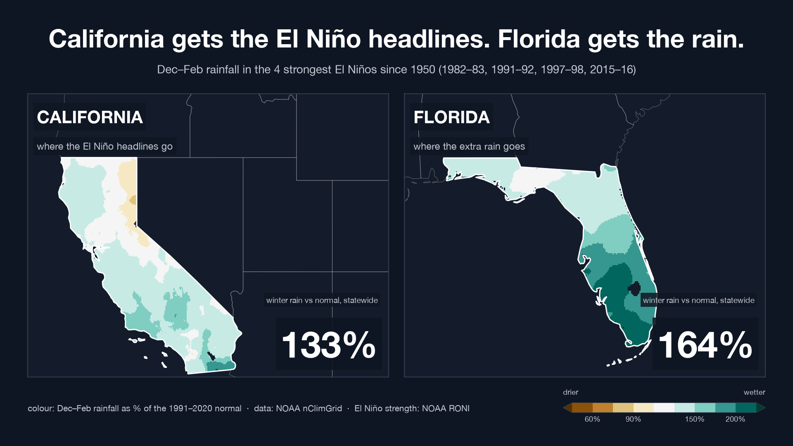
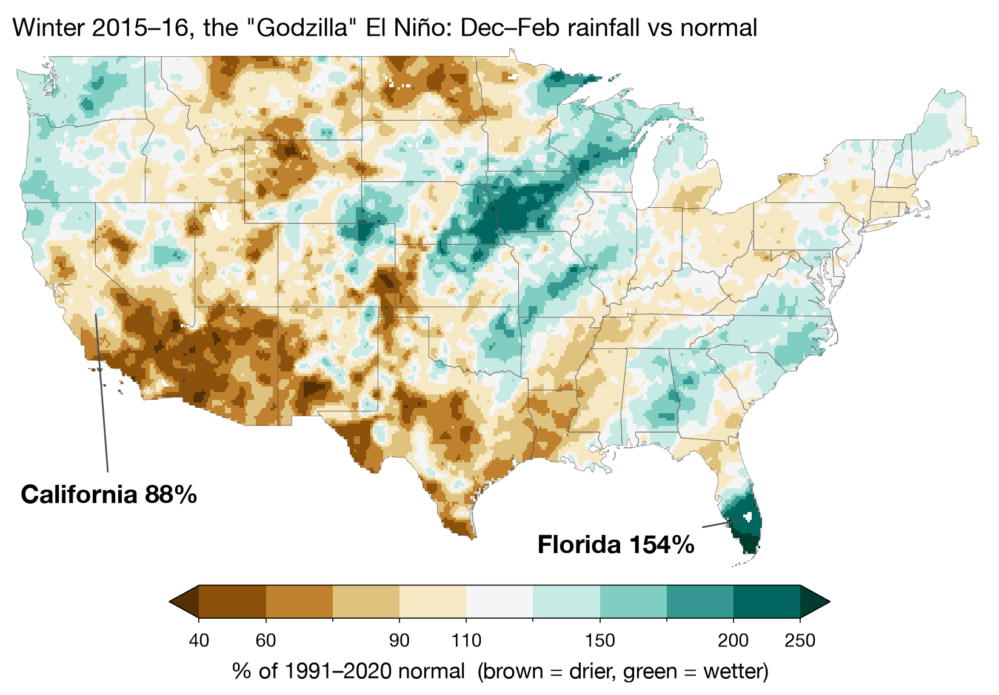
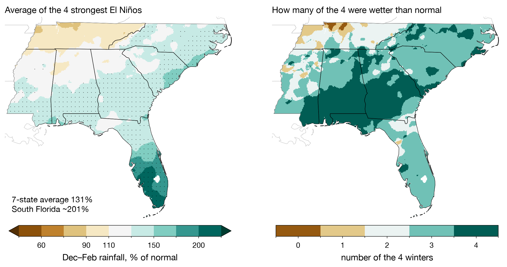
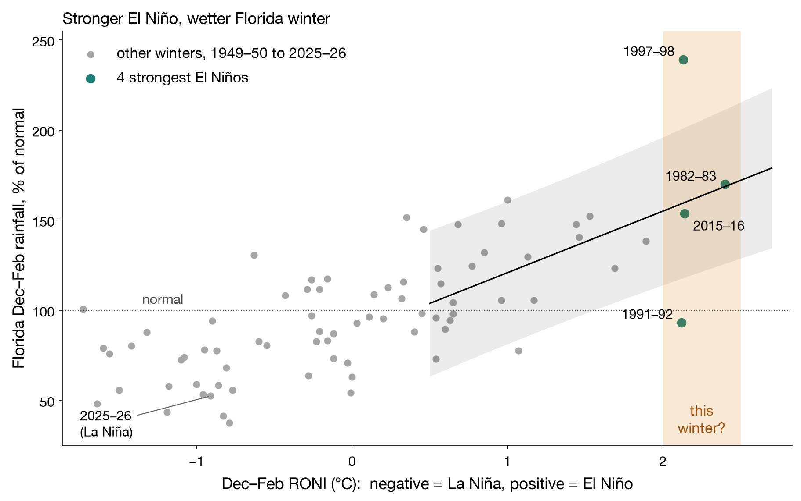
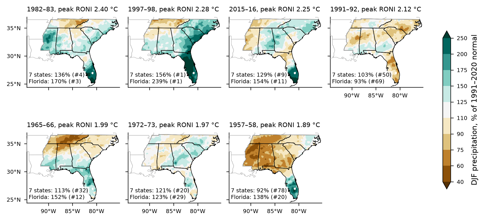
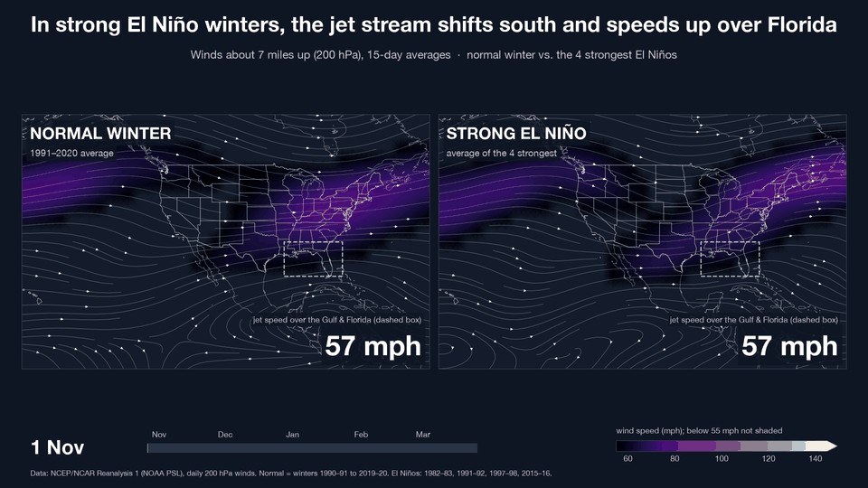

# Strong El Niño winters and US Southeast rainfall

How did the strongest El Niños on record change winter (December–February) rainfall in the seven US Southeast states (AL, FL, GA, MS, NC, SC, TN)? And how does Florida compare with California, where most El Niño attention goes?

This is the analysis behind the LinkedIn article *"California gets the El Niño headlines. Florida gets the rain."* (November 2026).

## Key results (nClimGrid, % of the 1991–2020 normal)

| | 4 strongest El Niños | 2015–16 only |
|---|---|---|
| Florida | 164% | 154% |
| California | 133% | 88% |
| 7-state Southeast average | 131% | 129% |
| South Florida (south of 28°N) | ~201% | ~229% |

- Florida ranks 2nd of the 48 lower states (after Texas) in the 4-event average; California ranks 9th.
- Florida's winter rainfall tracks El Niño strength: r = 0.72 with December–February RONI over 77 winters.
- In strong El Niño winters, the core of the 200 hPa jet along 85°W sits at about 30°N, against about 35°N normally.

## Results

These figures and tables were produced by `se_elnino_analysis.ipynb` (November 2026 run) and are kept in [`results/`](results/).

**Florida vs California, average of the 4 strongest El Niños**



**Winter 2015–16, the "Godzilla" El Niño**



**Southeast: 4-event average and how many of the 4 winters were wetter than normal**



**Stronger El Niño, wetter Florida winter**



**Each analog winter**



**Jet stream: normal winter vs strong El Niño (200 hPa, 15-day means, 1 Nov to 31 Mar)**



Other figures: [fig1_composite_signcount.png](results/figures/fig1_composite_signcount.png) (top-4 and all-7 composites with significance),
[fig3_roni_vs_rainfall.png](results/figures/fig3_roni_vs_rainfall.png) (7-state, Florida and Tennessee vs RONI),
[fig_hook_conus.png](results/figures/fig_hook_conus.png), [cover_B_godzilla_1920x1080.png](results/figures/cover_B_godzilla_1920x1080.png),
[jet_frame_20jan.png](results/figures/jet_frame_20jan.png).

Tables: [el_nino_event_ranking_roni_oni.csv](results/tables/el_nino_event_ranking_roni_oni.csv) (El Niño ranking),
[se_djf_pct_normal_by_winter.csv](results/tables/se_djf_pct_normal_by_winter.csv) (7-state / Florida / Tennessee % of normal and DJF RONI for every winter),
[conus_state_strong_elnino_djf.csv](results/tables/conus_state_strong_elnino_djf.csv) (all 48 states).

## Files

| File | What it is |
|---|---|
| `se_elnino_analysis.ipynb` | **The analysis.** The session's code cells, verbatim and in run order, grouped into 8 sections, **with the recorded outputs and figures of the November 2026 run**. |
| `se_elnino_analysis.py` | The same cells as a plain script (percent format), for reading on GitHub and diffing. |
| `plot_style.py` | The two plotting helpers the figure cells call (`apply_figure_style`, `panel_letter`). |
| `environment.yml` | Conda environment with the package versions used. |
| `results/` | Figures and tables from the November 2026 run. |

## Method in brief

1. **El Niño strength.** NOAA CPC's Relative Oceanic Niño Index (RONI), the official index since February 2026. Each winter's peak is the highest 3-month value from JJA to the following MAM.
2. **Analog winters.**
   - Top 4, peak ≥ 2.0 °C: 1982–83, 1991–92, 1997–98, 2015–16.
   - All 7, peak ≥ 1.85 °C: adds 1957–58, 1965–66, 1972–73.
3. **Rainfall.** NOAA nClimGrid monthly (~5 km, 1895–present). December–February totals, labelled by the December year. Anomalies are percent of the 1991–2020 normal.
4. **Significance.**
   - Each composite is compared with 5,000 random same-size sets of non-analog winters.
   - Field significance uses Benjamini–Hochberg FDR at α = 0.10.
   - Sign-count maps show how many analog winters were wetter than normal.
5. **Strength vs rainfall.** Linear fit on December–February RONI for El Niño winters, with an 80% prediction interval at 2.0–2.5 °C.
6. **Jet stream.** NCEP/NCAR Reanalysis 1 daily 200 hPa winds, as 15-day running means. The normal winter (1990–91 to 2019–20) is compared with the top-4 average.

## Run

```bash
conda env create -f environment.yml
conda activate se-elnino
cd se-elnino-winter-rainfall
jupyter lab se_elnino_analysis.ipynb      # run all cells, top to bottom
```

**About the outputs in the notebook.** They are the recorded outputs of the November 2026 run that produced the published results: printed output from the session's execution log, and each figure embedded under the cell that last saved it. Your own run should print the same numbers.

**Faster nClimGrid download.** NOAA's server sometimes throttles single connections (about 44 KB/s per connection in Nov 2026, so roughly 11 hours for the full file). Downloading over 16 connections at once was about 20 times faster in a test. With [aria2](https://aria2.github.io/) (`brew install aria2` on macOS):

```bash
mkdir -p data
aria2c -x 16 -s 16 -d data -o nclimgrid_prcp.nc \
  https://www.ncei.noaa.gov/data/nclimgrid-monthly/access/nclimgrid_prcp.nc
ls -l data/nclimgrid_prcp.nc      # should be 1,799,212,297 bytes
```

If you download this way, skip the notebook's download cell (section 2, first cell), which would fetch the file again.

Downloads: nClimGrid is ~1.8 GB, and the NCEP winds take ~10–20 min over OPeNDAP. Plan on ~4 GB of RAM. All outputs (CSV, NetCDF, PNG, MP4, GIF) are written next to the notebook.

## What differs from the original session

The cells are copied verbatim from the session's execution log, with only these changes:

1. **Plot helpers.** Two cells that loaded an in-session helper library are replaced by `from plot_style import ...`. That file applies the same matplotlib settings.
2. **One cell is joined with its rerun.** Cell 9 computed everything, then failed in its final print statement. The notebook keeps cell 9 up to that print and continues with cell 10, which reran the print and the per-state table. A comment marks the join.
3. **Shell download.** The nClimGrid download ran as a shell command; here it is a `%%bash` cell.
4. **One kernel.** Cells 1–2 ran in a second Python environment; here everything runs in one kernel.

**Left out:** diagnostic cells (connectivity and file checks), failed first attempts before network access was granted, the text edits to the LinkedIn article and post, and later repackaging work. None of these produced any of the published numbers or figures.

Draft figure cells are kept: each later cell overwrites the same file, so the final PNG is the published one.

## Data sources

- NOAA NCEI nClimGrid monthly: https://www.ncei.noaa.gov/data/nclimgrid-monthly/access/
- NOAA CPC RONI and ONI: https://www.cpc.ncep.noaa.gov/products/analysis_monitoring/enso/roni/
- NCEP/NCAR Reanalysis 1 (NOAA PSL): https://psl.noaa.gov/data/gridded/data.ncep.reanalysis.html
- State and country outlines: Natural Earth via `regionmask`

## Caveats

- Only 4 (or 7) analog events, and 1997–98 alone pulls the averages up.
- State averages hide differences within a state, especially for California.
- The 2026–27 range is an extrapolation from history, not a forecast.
- NCEP/NCAR Reanalysis has a 2.5° grid, which blurs the jet's edges.
