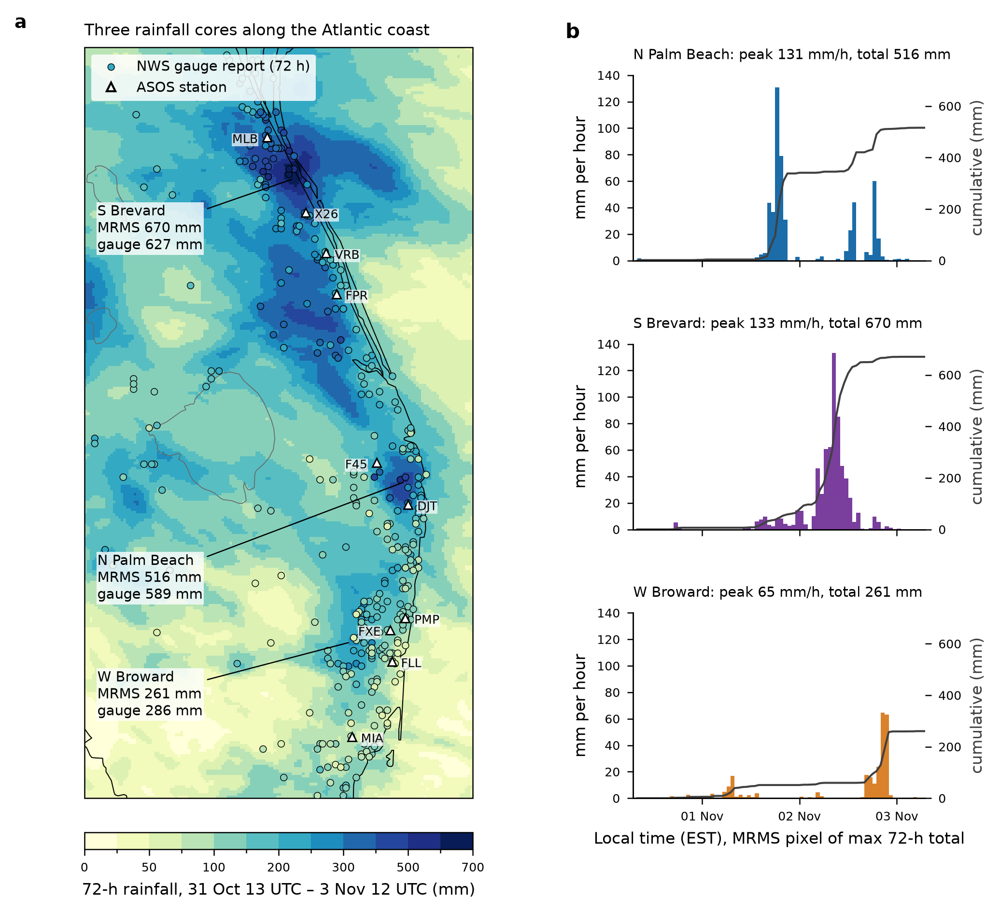
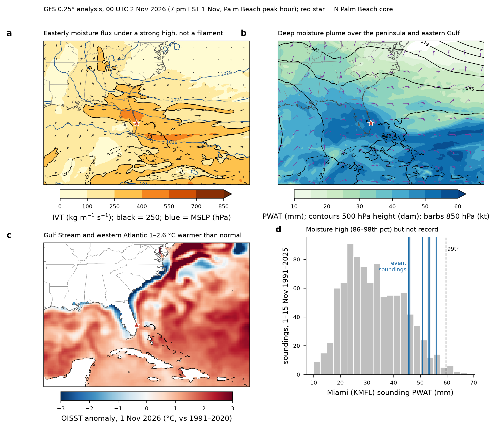

# Southeast Florida extreme rain, 1–3 November 2026: what happened and why

Diagnosis of the record rainfall in northern Palm Beach, southern Brevard and western Broward counties:
where it fell, which stations measured it, and what kind of storm it was (tropical system? atmospheric river? convection?),
from a climate and weather perspective.



## Key results

| Rain core | Highest NWS gauge, 72 h | MRMS peak | Nearest ASOS |
|---|---|---|---|
| **N Palm Beach** (3 W Riviera Beach, 26.78N 80.13W) | 589 mm (23.19 in) | 131 mm/h; 327 mm in 6 h ending 9 pm EST 1 Nov | Palm Beach Intl (`DJT`, formerly PBI) 11.0 km, F45 11.7 km |
| S Brevard (Grant-Valkaria / Malabar) | 627 mm (24.69 in) | 133 mm/h on 2 Nov | X59 0.2 km, X26 17.6 km, MLB 18.0 km |
| W Broward (Lauderhill / Sunrise / Davie) | 286 mm (11.26 in) | 79 mm/h, evening of 2 Nov | FXE 8.9 km, FLL 11.1 km |

- **Not a tropical cyclone.** The only system NHC monitored was a low expected to form later, several hundred miles northeast of the Bahamas.
- **Not a classic atmospheric river.** IVT over the cores was 280–480 kg m⁻¹ s⁻¹, above the usual 250 threshold, but it came from the east.
  It was a broad sheet south of a strong Mid-Atlantic high, about 5 million km² from 10–40°N. At the Palm Beach peak only −24 to +19 kg m⁻¹ s⁻¹ was poleward.
  A southwesterly, poleward plume only formed from 3 Nov. An AR test that uses only IVT ≥ 250 would wrongly flag this event.
- **Storms that stayed in place.** Over Miami the 850–300 hPa steering wind was only 2–4 m/s, under 7–9 m/s easterly inflow, so new cells kept forming upwind (back-building).
  The cores were organised differently:
  - Palm Beach: a small, fixed intense core (437 km² at ≥ 10 mm/h) inside a rain shield of at least 36,000 km².
  - Brevard: a mesoscale convective system (8,485 km² at ≥ 10 mm/h, with a mesoscale convective vortex noted by NWS Melbourne).
  - Broward: a smaller multicell cluster (4,123 km² at ≥ 2 mm/h).
- **Moisture high but not record.** Miami sounding PWAT was 53–56 mm, the 86th–98th percentile for 1–15 Nov 1991–2025; the record is 67.2 mm. Warm-cloud depth was about 4 km.
- **Warm ocean.** OISST was +1.0 °C above the 1991–2020 normal over the Gulf Stream off Southeast Florida and +1.4 °C over the western Atlantic (maximum +2.6 °C).
- **Interpretation.** Warm, moist air and strong onshore flow made each hour very heavy. A coastal trough fixed the lift along the coast, and an upper low over the Gulf added lift aloft.
  Weak steering winds then held the storms over the same neighbourhoods for 6–12 h. The 6-h Palm Beach total is about 6× the column water vapour, so the storms drew moisture in from a wide area.
  No formal attribution was done.
- **Storm-type labelling note.** A season rule (Nov–Apr = frontal) would label this event "cool-season frontal". It actually behaved like warm-season organised convection.

Plain-language write-ups: [`writing/event_summary.md`](writing/event_summary.md) and [`writing/thermodynamics_vs_dynamics.md`](writing/thermodynamics_vs_dynamics.md).



## Folder layout

```
notebooks/   session code, verbatim and in run order, split by the kernel it ran in, with recorded outputs
results/     figures/ (2 figures) and tables/ (8 CSVs, see below)
writing/     event summary, thermodynamics-vs-dynamics explainer, prompt for a follow-up animation
docs/        cell_map.csv: notebook cell -> original session cell, env, status, time it ran (UTC)
style.py     stand-in for the plotting helper used in the session
```

| Notebook | Env | Content | Session cells |
|---|---|---|---|
| `01_reports_stations_soundings.ipynb` | `python` (environment-01.yml) | IEM: ASOS stations and hourly rain, NWS LSRs, PNS rainfall reports (parsed), AFDs; KMFL sounding PWAT climatology and kinematics; OISST download | 17 |
| `02_radar_gfs_ar_figures.ipynb` | `precip` (environment.yml) | MRMS QPE Pass2 hourly, GFS 0.25° analyses (IVT, PWAT, CAPE), AR object test, MRMS rain-object areas, OISST anomalies, figures | 22 |

The two notebooks ran side by side in two kernels; `docs/cell_map.csv` gives the interleaved original order.
To reproduce, run notebook 01 completely and then notebook 02 from this folder. Notebook 02 reads files written by 01:
`event/pns_72h.csv`, `event/fl_asos_meta.csv`, `event/kmfl_pwat.csv` and the OISST files.

## Important: what these notebooks are

**Outputs shown are the recorded outputs of the original run** (printed text, and each figure embedded in the last cell that saved it).
They were attached from the run log, not produced by re-executing the notebooks. Printouts over 20,000 characters are truncated with a note,
and local file paths were shortened to `./` or `~/`.

The code cells are an **exact export of the analysis session** (39 cells), not a refactored package. Failed cells (7) are kept and marked,
because the following cell is usually the fix. Only one setup cell per notebook was added (working directory; `style.py` import).
Excluded: an auto-injected plotting-helper cell, a no-op cell and the platform control-plane cells (none contained analysis).

## Data sources (all public, no login)

| Data | Access used |
|---|---|
| ASOS hourly precipitation, station metadata | IEM `cgi-bin/request/hourlyprecip.py`, `geojson/network.py?network=FL_ASOS` |
| NWS Local Storm Reports | IEM `geojson/lsr.php` (WFOs MFL, MLB) |
| NWS text products (PNS 72-h rainfall reports, AFD, FFW/FFS) | IEM `cgi-bin/afos/retrieve.py` |
| Miami (KMFL) radiosondes, 1991–2026 | IEM `cgi-bin/request/raob.py` |
| MRMS MultiSensor_QPE_01H_Pass2 | AWS `noaa-mrms-pds` |
| GFS 0.25° analyses (f000) | AWS `noaa-gfs-bdp-pds`, byte ranges from `.idx` |
| NOAA OISST v2.1 daily (preliminary), anomaly vs 1991–2020 | NCEI `data/sea-surface-temperature-optimum-interpolation/v2.1/access/avhrr/` |

Raw downloads (MRMS, GFS GRIB, OISST NetCDF, text products) go in `event/` and are not tracked. About 72 MRMS files plus 15 GFS subsets, roughly 0.5 GB.

## Tables in `results/tables/`

| File | Content |
|---|---|
| `asos_event_summary.csv` | per ASOS station: totals, max 1-h and 6-h rain with times, daily totals (local time) |
| `pns_72h_vs_mrms.csv` | every NWS 72-h gauge report with coordinates, plus MRMS at the pixel and 3×3 max |
| `mrms_core_maxima.csv` | MRMS maxima per core for 1, 3, 6, 12, 24 and 72 h |
| `gfs_core_point_series.csv` | 6-hourly IVT, IVT direction, PWAT and CAPE at each core |
| `ar_object_diagnostics.csv` | IVT ≥ 250 object containing each core: area, length, L/W, mean zonal and poleward IVT |
| `kmfl_pwat.csv` | PWAT for every Miami sounding 15 Oct–15 Nov 1991–2025, plus the event |
| `kmfl_kinematics.csv` | event soundings: steering wind, 925–850 hPa wind, Corfidi upwind vector, freezing level, LCL, warm-cloud depth |
| `lsr_MFL_MLB.csv` | NWS flood and wind Local Storm Reports, 31 Oct–4 Nov |

## Caveats

- **MRMS vs gauges.** MRMS Pass2 is gauge-adjusted, so its agreement with the NWS gauges (median ratio 1.01, r = 0.87, n = 334) is not independent.
- **Bad ASOS gauges.** Some ASOS precipitation records are unreliable here. F45 logged 51 mm while 489 mm fell 6 km away, X59 logged 5 mm on the Brevard maximum, and TIX, COI, SUA, LNA and TMB report flat zeros.
- **Miami sounding location.** KMFL is about 100 km south of the Palm Beach core.
- **No IVT climatology.** IVT is tested against a fixed 250 kg m⁻¹ s⁻¹ threshold and geometry only, not climatological percentiles, because ERA5 was not available in this session.
- **Preliminary SST.** OISST values are preliminary.
- **No attribution.** This is a diagnosis of the event, not an attribution study.
- **Times.** Hyetograph times are labelled EST; DST ended at 2 am on 1 Nov.
