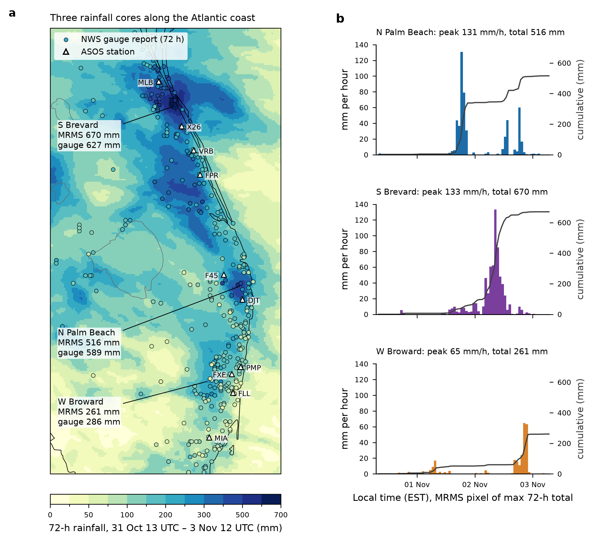
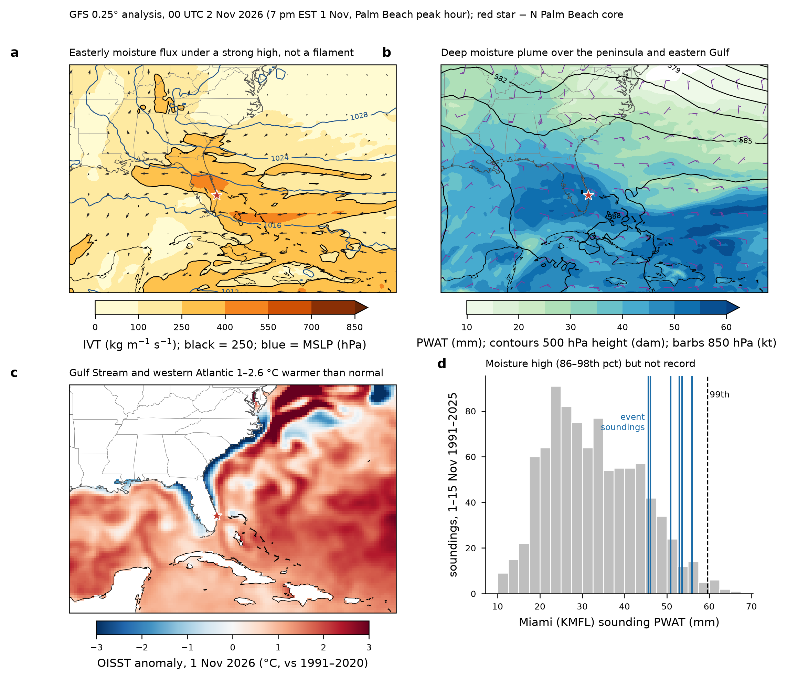

# 1–3 November 2026 Southeast Florida rain: summary

The most intense South Florida rain fell in **northern Palm Beach County**. It was not a tropical system and not a classic
atmospheric river. Slow-moving convection, fed by strong and very moist easterly (onshore) winds, sat over the same spots for hours,
over an unusually warm ocean.

## Where and how much

Three rain centres (72-h totals from NWS gauge reports and MRMS radar-plus-gauge rainfall):

| Centre | Highest gauge, 72 h | Peak rain (MRMS) | Closest ASOS stations |
|---|---|---|---|
| **N Palm Beach** (3 W Riviera Beach, 26.78°N 80.13°W) | 589 mm (23.19 in) | 131 mm/h; 327 mm in 6 h ending 9 pm EST 1 Nov | Palm Beach Intl ("DJT") 11.0 km, F45 11.7 km |
| S Brevard (Grant-Valkaria / Malabar) | 627 mm (24.69 in) | 133 mm/h on 2 Nov | X59 0.2 km, Valkaria AFS (X26) 17.6 km, MLB 18.0 km |
| W Broward (Lauderhill / Sunrise / Davie) | 286 mm (11.26 in) | 79 mm/h, evening of 2 Nov | FXE 8.9 km, FLL 11.1 km |

- **Palm Beach Intl:** 108.7 mm on 1 Nov and 187.5 mm on 2 Nov. The 2 Nov total matches the 7.39 in reported as a new daily record, replacing 2.52 in from 1925 [3].
- **"1,000-year":** local media and the city of West Palm Beach described northern Palm Beach County as possibly exceeding 1-in-1,000-year thresholds [1, 2].
  That is based on a reported 17 in in 6 h in Palm Beach Gardens, against a threshold of about 9 in [2].
  MRMS gives a lower 6-h peak of 12.9 in. Its 72-h totals match the gauges closely (median ratio 1.01, r = 0.87, n = 334), but that is not independent because this MRMS product is gauge-adjusted.
- **Faulty gauges:** F45 logged 51 mm while 489 mm fell 6 km away, X59 logged 5 mm on the Brevard maximum, and TIX, COI, SUA, LNA and TMB report flat zeros.
- **Impacts:** NWS flood reports include water entering homes near Northlake Blvd and in Lone Pine Estates (Riviera Beach), and stalled cars at Sawgrass Mills.
  Palm Beach Police confirmed one flood death [4].

## What caused it

1. **Not a tropical cyclone.** NHC monitored only a low expected to form later along a weakening front, several hundred miles northeast of the Bahamas [5].
2. **Not a classic AR.** IVT over the cores was 280–480 kg m⁻¹ s⁻¹, above the usual 250 threshold, but it came from the east.
   It was a broad sheet about 5 million km² in size, spanning 10–40°N, south of a strong high over the Mid-Atlantic.
   At the Palm Beach peak only −24 to +19 kg m⁻¹ s⁻¹ was heading north; a true AR is a narrow plume carrying moisture poleward.
   An AR-like southwesterly plume only formed from 3 Nov.
3. **Convective storms that didn't move.**
   - Over Miami the 850–300 hPa steering winds were only 2–4 m/s, while 7–9 m/s easterly low-level winds kept feeding the storms.
     New cells formed upwind as older ones moved off.
   - Palm Beach was a small, fixed intense core (437 km² at ≥ 10 mm/h) inside a rain shield of at least 36,000 km².
   - Brevard was a mesoscale convective system (8,485 km² at ≥ 10 mm/h); NWS Melbourne noted a well-defined mesoscale convective vortex.
   - Broward was a smaller multicell cluster.
4. **Triggers.** NWS forecasters pointed to a coastal trough, an upper low over the Gulf providing lift aloft, and a stalled boundary over South Florida lifting north.
5. **Moisture high but not record.** Miami soundings measured 53–56 mm of PWAT, the 86th–98th percentile for 1–15 Nov (1991–2025); the record is 67.2 mm.
   Warm-cloud depth was about 4 km, which makes rain production very efficient.
6. **Warm ocean.** The Gulf Stream east of Southeast Florida was +1.0 °C above normal, and the western Atlantic +1.4 °C (up to +2.6 °C).
   Yale Climate Connections also noted record-to-near-record warm ocean temperatures off the east coast [6].

**Climate perspective:** the moisture supply was elevated and the ocean warm (roughly 7% more water vapour per °C).
But moisture alone was not extreme; the rare totals came from storms staying in place for 6–12 hours.

## Limitations

- KMFL is about 100 km south of the Palm Beach core.
- IVT was not ranked against climatology (no ERA5 in this session).
- OISST values are preliminary.
- No formal attribution was done.

Possible next steps: ERA5 IVT percentiles and a Guan–Waliser AR test, NOAA Atlas 14 return levels, and placing the event in the 2015–2025 product evaluation.

## Sources (news reports, read 4 Nov 2026)

1. CBS12 (WPEC), "Record rainfall floods Palm Beach County neighborhoods, disrupts services and polling", 3 Nov 2026. https://cbs12.com/news/local/heavy-flooding-forces-evacuations-polling-changes-palm-beach-county-severe-flooding-heavy-residents-displaced-from-lone-pine-area-city-of-riveria-beach-florida-news
2. Yale Climate Connections, "Colossal rains and flash floods hammer the U.S. Southwest and Florida peninsula", Nov 2026. https://yaleclimateconnections.org/2026/11/colossal-rains-and-flash-floods-hammer-the-u-s-southwest-and-florida-peninsula/
3. Palm Beach Post via Yahoo News, "Nine Palm Beach County schools will be closed Wednesday after heavy rain, flooding", 3 Nov 2026. https://www.yahoo.com/news/weather-news/articles/nine-palm-beach-county-schools-001900394.html
4. NBC6 Miami, "Flooding closes school, impacts voting and covers roads in South Florida. Why is it raining so much?", 3 Nov 2026. https://www.nbcmiami.com/weather/stories-weather/flooding-closes-school-impacts-voting-in-south-florida-why-is-it-raining-so-much/3882562/
5. WFLA, "NHC monitoring disturbance off U.S. east coast", 2 Nov 2026. https://www.wfla.com/weather/tracking-the-tropics/nhc-monitoring-disturbance-off-u-s-east-coast/
6. Same as [2].

NWS products used (via IEM): PNSMFL / PNSMLB 72-h rainfall reports, AFDMFL / AFDMLB discussions, and MFL/MLB Local Storm Reports.
